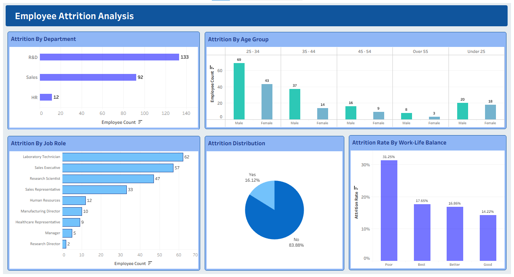
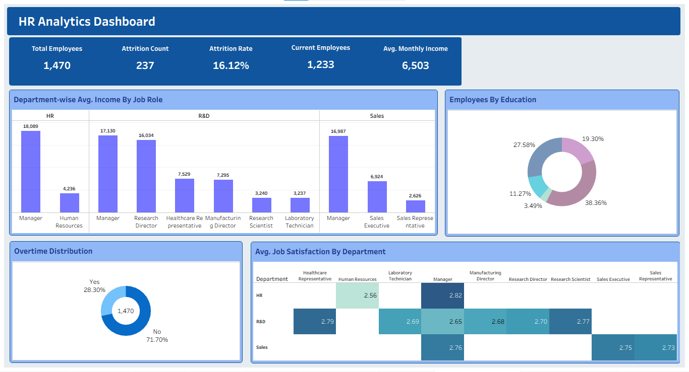

# HR Analytics & Employee Attrition Dashboard

An end-to-end **HR Analytics Dashboard** built to analyze employee data, track performance metrics, and uncover key drivers behind employee attrition. This project provides actionable insights for HR departments to improve retention strategies, manage workloads, and optimize compensation structures.

---

## 📊 Dashboards Overview

### 1. HR Analytics Dashboard
The main dashboard gives a comprehensive high-level overview of the organization's workforce distribution, income levels, and overall employee satisfaction.

**Key Insights & Features:**
*   **KPI Summary Cards:** Track key metrics instantly, including **Total Employees (1,470)**, **Attrition Count (237)**, **Attrition Rate (16.12%)**, **Current Active Employees (1,233)**, and **Average Monthly Income ($6,503)**.
*   **Department-wise Avg. Income by Job Role:** A breakdown of monthly income across HR, R&D, and Sales departments showing stark contrasts between managerial roles and technical/execution staff.
*   **Employees by Education:** A donut chart showing demographic education levels across the workforce.
*   **Overtime Distribution:** Visualizes that **28.30%** of the workforce works overtime, a potential leading indicator for burnout.
*   **Avg. Job Satisfaction Heatmap:** Maps job satisfaction ratings (out of 5) across departments and job roles to pinpoint low-morale segments (e.g., HR Human Resources at 2.56).

### 2. Employee Attrition Analysis
This specialized view dives deep into historical attrition data to identify trends based on demographics, job roles, and work-life balance factors.

**Key Insights & Features:**
*   **Attrition by Department:** Highlights that **R&D** has the highest total attrition volume (**133 employees**), followed by **Sales (92)** and **HR (12)**.
*   **Attrition by Age Group & Gender:** Shows that the **25–34 age bracket** experiences the highest attrition, heavily driven by male employees (69 count).
*   **Attrition by Job Role:** Identifies vulnerable positions, with **Laboratory Technicians (62)** and **Sales Executives (57)** leading the turnover metrics.
*   **Attrition Rate by Work-Life Balance:** Directly correlates poor balance with turnover, showing a massive **31.25% attrition rate** among employees reporting "Poor" work-life balance compared to just 14.22% for "Good".

---

## 🛠️ Tools & Technologies Used
*   **Business Intelligence / Data Visualization:** Power BI / Tableau / Excel (Adjust based on your choice)
*   **Data Source:** HR Employee Performance & Attrition dataset (CSV/SQL database)
*   **Data Transformation:** Power Query / Pandas for ETL processes

---

## 💡 Key Actionable Recommendations
1.  **Work-Life Balance Interventions:** Address the high turnover rate (31.25%) in the "Poor" work-life balance segment by reviewing overtime policies (currently affecting 28.30% of employees).
2.  **Targeted Retention for Critical Roles:** Formulate specialized retention plans, mentorships, or career growth pathways for **Laboratory Technicians** and **Sales Executives** who represent over half of all departures.
3.  **Address Low Satisfaction Segments:** Investigate the underlying causes of the low job satisfaction score (**2.56**) among HR generalists/personnel.
